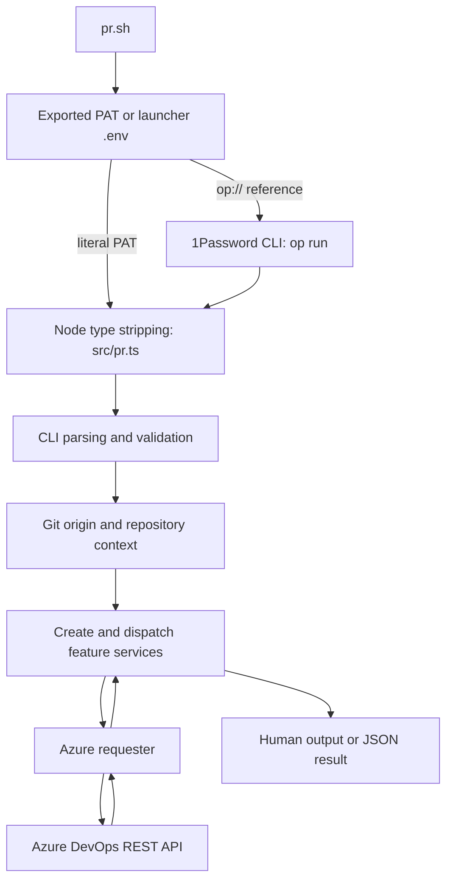
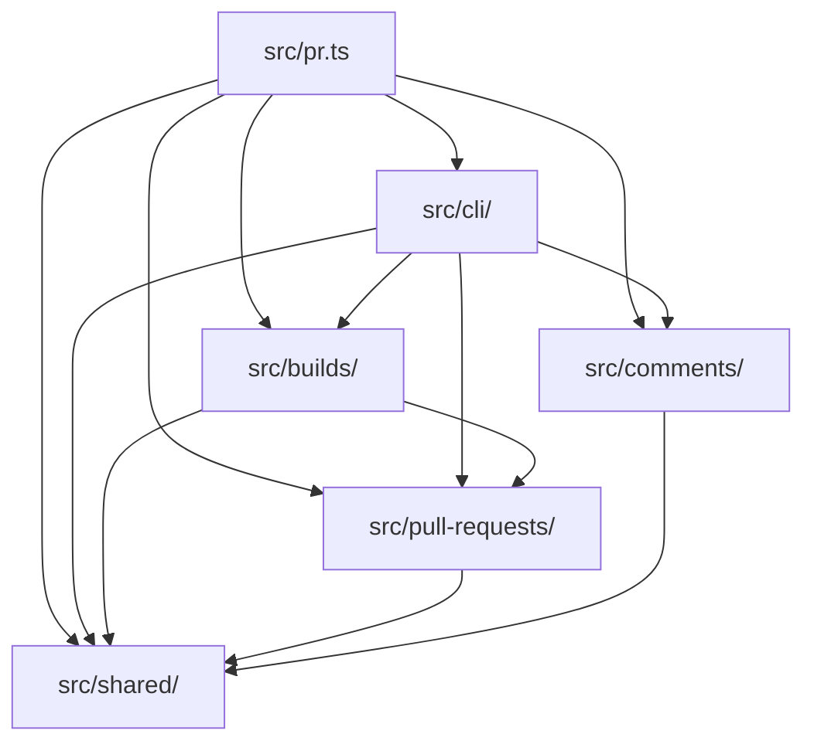

# Architecture

ado-pr is a small TypeScript CLI for developers' coding agents working in Azure
Repos checkouts. It manages pull requests, review comments and PR validation builds.
It runs from source on Node >= 22.6 with native type stripping and no build step,
as recorded in [ADR 0005](adr/0005-run-typescript-directly.md).

## Runtime flow

Run `pr.sh` from the target checkout. The launcher finds its own source and
dependencies without changing the caller's working directory. It prefers an
exported `AZURE_DEVOPS_PAT`, then loads `.env` beside the launcher. Literal values
use Node's dotenv loader; `op://` references use `op run` for resolution. A
1Password Environment named pipe supplies literal dotenv values and is read once.
The TypeScript entrypoint requires a resolved PAT.

`src/pr.ts` calls `parseArgs` before reading credentials or Git context, so direct
Node invocation can show help without authentication. It creates one requester,
injects it and the repository context into the services, dispatches the command
and selects output and exit status. PR resolution uses an explicit ID or the
current branch where the command allows it.

## Modules and dependencies

- `src/shared/` owns `createAzureRequester`, Azure URL helpers, Git context and
  subprocess helpers. It also owns command contracts used by CLI parsing, help
  and comment batch validation, plus shared operation types and exit-code rules.
- `src/pull-requests/` exports `createPullRequestService` for PR lookup, listing,
  creation and editing, including description images and reviewers. It provides
  PR metadata used to associate validation builds with a PR.
- `src/comments/` exports `createThreadService` for filtering, formatting and
  changing threads; `createFileAnchorService` for iteration-aware file and line
  anchors with reusable caches; and `createBatchRunner` for validating stdin JSON
  operations before executing them sequentially and reporting each result.
- `src/builds/` exports `createBuildService` for listing associated validations,
  reading timeline/log diagnostics, retrying eligible builds and waiting for
  completion. It checks repository, PR and merge association. Support covers
  YAML/classic Build API validations, excluding Releases and external checks.
- `src/cli/` owns `parseArgs`, `getPat`, help rendering and typed CLI options.
  It interprets the shared command registry and validates command-specific flags.
- `src/pr.ts` composes the services, handles process signals for build wait and
  routes command output.

Arrows show permitted imports between modules, including type-only imports.
They describe dependency permissions, not every current import.

Features depend on shared code; builds may also depend on pull requests. Only the
CLI and entrypoint may wire features together. Shared code cannot depend on a
feature, and features cannot depend on the CLI. `.fallowrc.json` declares these
folders as boundary zones with explicit allowed dependencies.
`pnpm fallow:architecture` rejects violations. See
[ADR 0002](adr/0002-organise-code-by-feature.md).

## Azure requests and output

The requester centralises PAT Basic authentication, JSON or raw request bodies,
JSON/text/no-content responses and optional status/header metadata. Callers can
set timeouts, cancellation signals and successful response byte limits. Timeouts
and cancellation cover body reads as well as the initial fetch. Error excerpts
have a fixed size limit. There is no general default request timeout or practical
success-body limit; feature callers select them where needed.

`AzureRequestError` classifies HTTP, network, timeout, caller-abort and response
failures, with status and Retry-After metadata when available. Error messages
redact credentials and sensitive values, strip terminal controls and bound details.
This sanitisation applies to diagnostics, not all successful API data. Build
waiting decides which transient read failures to retry; the requester does not
automatically retry mutations.

Results and mutation confirmations go to stdout. Commands that accept `--json`
emit their result there as JSON instead of human formatting. Help, usage errors,
failures and build wait progress go to stderr. Batch operations report successes
on stdout and failures on stderr, continue after operation failures, and exit 1
if any failed. `build show` also exits 1 if diagnostics include log read errors.

`build wait` exits 0 only for `succeeded`, 1 for other terminal outcomes or errors,
and 124 for its deadline. SIGINT and SIGTERM cancel local work and exit 130 and
143 respectively, without a final result or cancellation of the remote build.
A repeated signal forces exit.

## Tests and quality gates

Tests use `node:test` in adjacent `.test.mjs` files. `tests/test-helpers.mjs`
provides isolated Git repositories, environment/global-state helpers and bounded
subprocess runners. The FIFO fetch implementation in
`tests/support/fetch-harness.mjs` backs in-process mocks and
`tests/fixtures/fetch-preload.mjs`. The preload replaces fetch in CLI subprocesses,
records requests with redacted authorisation, and rejects unused or unexpected
responses. CLI subprocess tests check streams, exit codes and signals; launcher
tests use temporary dotenv files, pipes and a fake `op` executable.

`pnpm check` runs TypeScript checking, Biome lint/format checks, tests and Fallow.
Fallow collects fresh V8 coverage, including CLI subprocess coverage, then checks
dead code, duplicates, architecture boundaries and a CRAP limit of 12. The existing
health baseline identifies functions awaiting refactoring; do not add entries.

GitHub Actions checks Node 22 and 24 and runs lint and Fallow. PR mutation checks
use Fallow's native node:test runner against the PR base, with a minimum score of
71 and a target of 80. `pnpm mutation` defaults to `origin/main`, overridable with
`MUTATION_BASE`. Full runs use `pnpm mutation:all`, report the score and run in CI
only through `workflow_dispatch`. See [ADR 0004](adr/0004-quality-gates.md).

The [ADR index](adr/README.md) records decisions behind these rules. Keep changes
proportionate to this tool's users and realistic failures, as described in
[ADR 0003](adr/0003-keep-the-tool-small.md).
