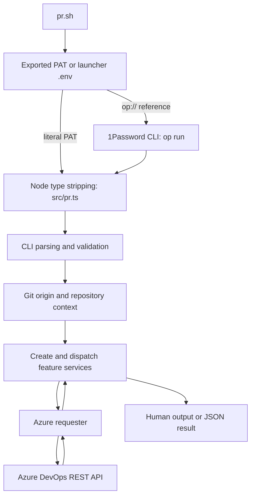
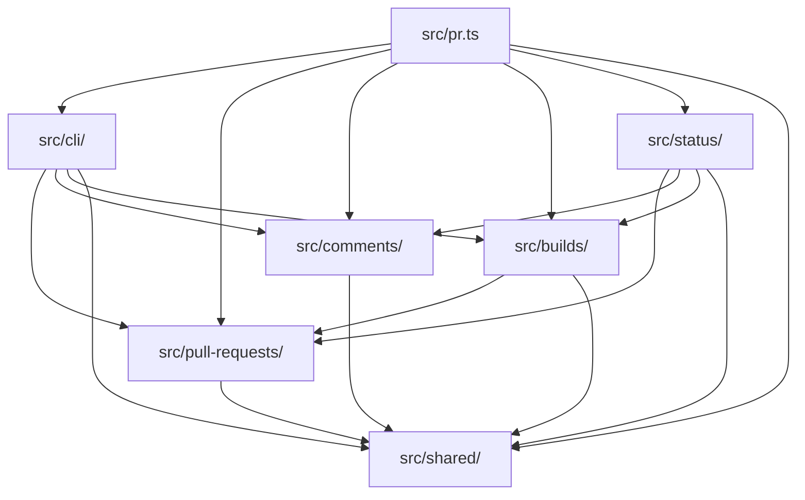

# Architecture

ado-pr is a small TypeScript CLI for developers' coding agents working in Azure
Repos checkouts. It manages pull requests, review comments and PR validation builds, and reports a PR's state in one call.
It runs from source on Node >= 22.6 with native type stripping and no build step,
as recorded in [ADR 0005](adr/0005-run-typescript-directly.md).

## Runtime flow

Link the launcher into a directory on PATH, as `AGENTS.md` describes, then run
`pr.sh` from the target checkout. The launcher resolves its real path with
`readlink -f` to find its source and dependencies without changing the caller's
working directory. It prefers an exported `AZURE_DEVOPS_PAT`, then loads `.env`
beside the real script. Literal values use Node's dotenv loader; `op://` references
use `op run` for resolution. A 1Password Environment named pipe supplies literal
dotenv values and is read once. The TypeScript entrypoint requires a resolved PAT.

`src/pr.ts` parses arguments before reading credentials or Git context, so direct
Node invocation can show help without authentication. It creates one requester,
injects it and the repository context into the services, dispatches the command
and selects output and exit status. PR resolution uses an explicit ID or the
current branch where the command allows it.

## Modules and dependencies

- `src/shared/`: Azure HTTP access, URL helpers, Git repository context and the
  command contracts and types that several modules use.
- `src/pull-requests/`: finding, listing, creating and editing pull requests,
  including generic attachment uploads, description images and reviewers.
- `src/comments/`: review threads and comments, file and line anchors, and batch
  operations read from stdin.
- `src/builds/`: PR validation builds: listing, queueing, diagnostics and logs,
  retries and waiting for completion.
- `src/status/`: the `pr status` application service. It combines the pull request,
  the build validating its head, review threads and merge conflicts into one report,
  and owns the best-effort Copilot review matching.
- `src/cli/`: argument parsing, validation, help and PAT lookup.
- `src/pr.ts`: wires the modules together, dispatches commands and writes output.

Arrows show permitted imports between modules, including type-only imports.
They describe dependency permissions, not every current import.

Features depend on shared code; builds may also depend on pull requests. Status
may depend on pull requests, comments and builds, so those features stay independent
of each other ([ADR 0007](adr/0007-report-pr-status-from-a-status-module.md)). Only
the CLI and entrypoint may wire features together. Shared code cannot depend on a
feature, and features cannot depend on the CLI. `.fallowrc.json` declares these
folders as boundary zones with explicit allowed dependencies.
`pnpm fallow:architecture` rejects violations. See
[ADR 0002](adr/0002-organise-code-by-feature.md).

## Azure requests and output

The requester centralises PAT Basic authentication, JSON or raw request bodies,
JSON/text/no-content responses and optional status/header metadata. Callers can
set timeouts, cancellation signals and successful response byte limits. Timeouts
and cancellation cover body reads as well as the initial fetch. Error excerpts
have a fixed size limit. There is no general default request timeout or practical
success-body limit; feature callers select them where needed.

Request errors are classified as HTTP, network, timeout, caller-abort or response
failures, with status and Retry-After metadata when available. Error messages
redact credentials and sensitive values, strip terminal controls and bound details.
This sanitisation applies to diagnostics, not all successful API data. Build
waiting decides which transient read failures to retry; the requester does not
automatically retry mutations.

Results and mutation confirmations go to stdout. Commands that accept `--json`
emit their result there as JSON instead of human formatting. Help, usage errors,
failures and build wait progress go to stderr. Batch operations report successes
on stdout and failures on stderr, continue after operation failures, and exit 1
if any failed. `build show` also exits 1 if diagnostics include log read errors or
`--latest` falls back to a stale associated build. Show and wait require an explicit
build ID or `--latest`, which selects the newest build validating the PR head. Both
accept PR merge builds and source-branch builds under
[ADR 0006](adr/0006-match-builds-to-the-pr-head.md). Build listing still includes
only PR merge builds.

`pr status` prints one human report and has no `--json` yet. It reads the PR, the
validating build, all threads and, only when `mergeStatus` is `conflicts`, the
conflict list, one request after another. A build that does not validate the head is
marked stale; with no build it says so. Both exit 0. If the conflict list cannot be
read, the report says so and still shows the merge status. The Copilot line is the
newest system comment in the threads that mentions a Copilot review, reported as
`completed` or `requested` with its date, or `none`. Other wording, such as a
cancellation, still counts as the newest entry and is shown as quoted text with its
date. It is best effort because Azure's wording is unverified. See
[ADR 0007](adr/0007-report-pr-status-from-a-status-module.md).

`build wait` exits 0 only for `succeeded`, 1 for other terminal outcomes or errors,
and 124 for its deadline. SIGINT and SIGTERM cancel local work and exit 130 and
143 respectively, without a final result or cancellation of the remote build.
A repeated signal forces exit.

## Tests and quality gates

Tests use `node:test` in adjacent `.test.mjs` files. `tests/test-helpers.mjs`
provides isolated Git repositories, environment/global-state helpers and bounded
subprocess runners. The FIFO fetch implementation in
`tests/support/fetch-harness.mjs` backs in-process mocks and
`tests/fixtures/fetch-preload.mjs`. The preload replaces fetch in CLI subprocesses,
records requests with redacted authorisation, and rejects unused or unexpected
responses. CLI subprocess tests check streams, exit codes and signals; launcher
tests use temporary dotenv files, pipes and a fake `op` executable.

`pnpm check` runs TypeScript checking, Biome lint/format checks, tests and Fallow.
Fallow collects fresh V8 coverage, including CLI subprocess coverage, then checks
dead code, duplicates, architecture boundaries and a CRAP limit of 12.

GitHub Actions checks Node 22 and 24 and runs lint and Fallow. PR mutation checks
use Fallow's native node:test runner against the PR base, with the minimum score
set in the `mutation` script. `pnpm mutation` defaults to `origin/main`, overridable with
`MUTATION_BASE`. Full runs use `pnpm mutation:all`, report the score and run in CI
only through `workflow_dispatch`. See [ADR 0004](adr/0004-quality-gates.md).

The [ADR index](adr/README.md) records decisions behind these rules. Keep changes
proportionate to this tool's users and realistic failures, as described in
[ADR 0003](adr/0003-keep-the-tool-small.md).
