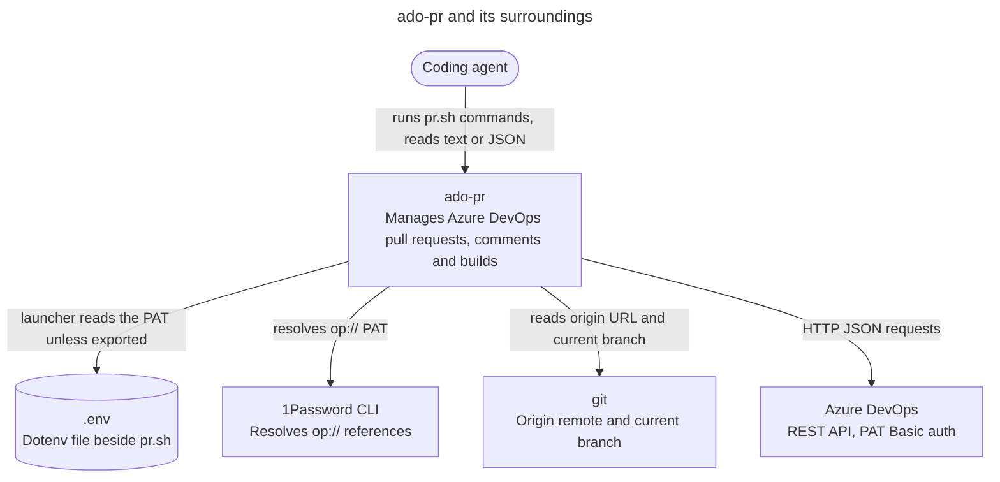
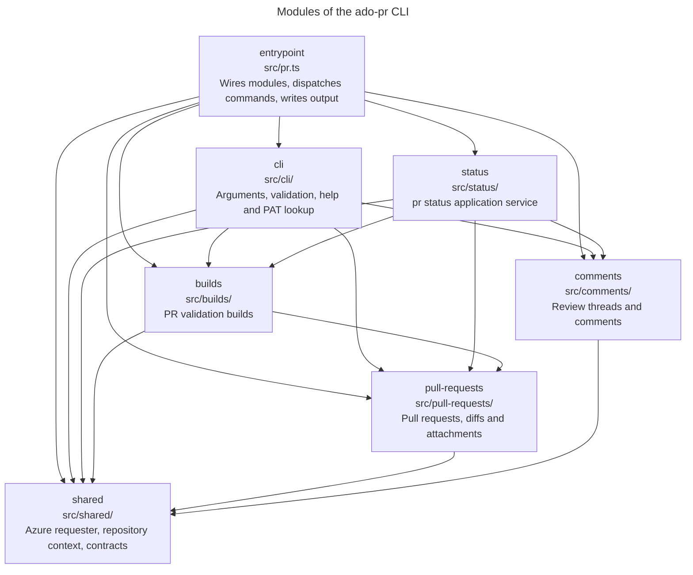
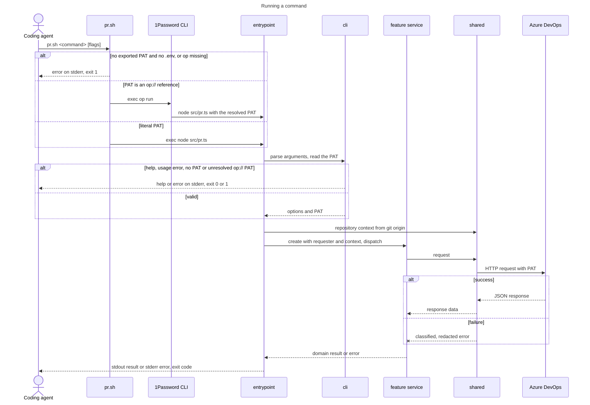
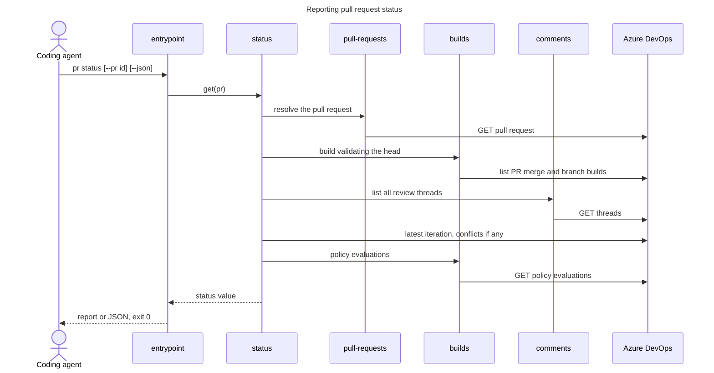
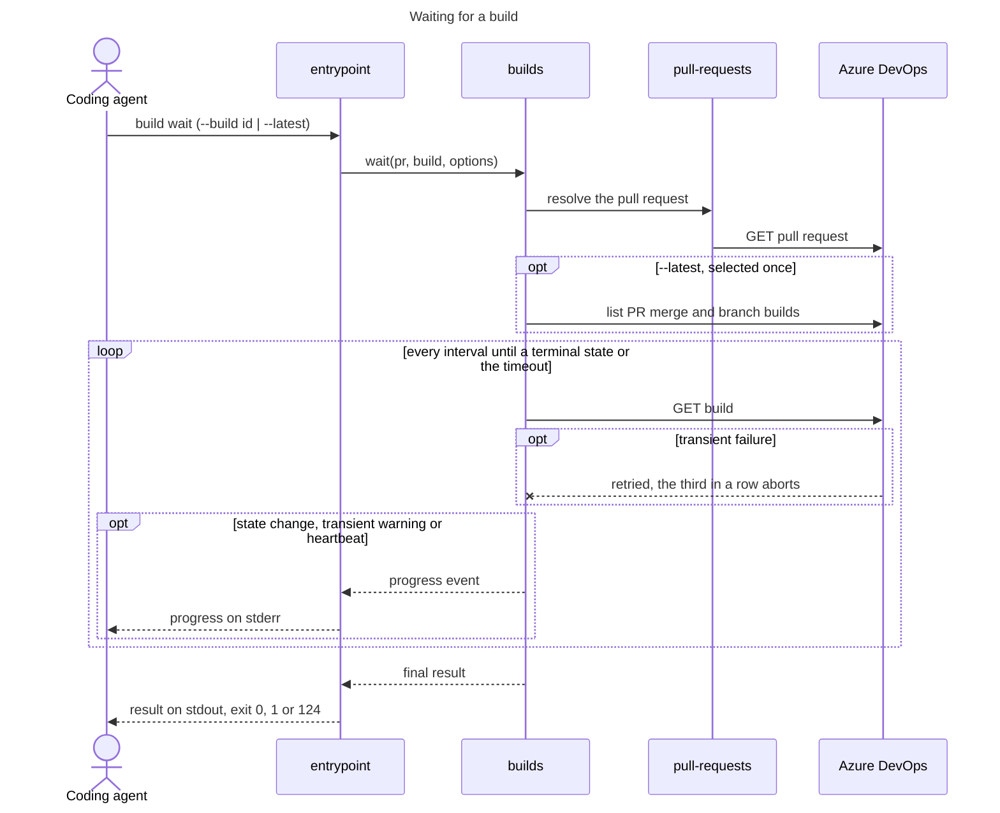

# ado-pr architecture

ado-pr is a small TypeScript CLI for developers' coding agents working in Azure
Repos checkouts. It manages pull requests, review comments and PR validation builds,
and reports a pull request's state in one call. It runs from source on Node >= 22.6
with native type stripping and no build step
([ADR 0005](adr/0005-run-typescript-directly.md)). Code is organised by feature with
enforced dependency rules ([ADR 0002](adr/0002-organise-code-by-feature.md)) and
kept small ([ADR 0003](adr/0003-keep-the-tool-small.md)).

## Domain language

- **Pull request**: an Azure Repos pull request from a source branch into a target
  branch. Commands find it by ID or from the current branch.
- **PR head**: the newest source commit of a pull request
  (`lastMergeSourceCommit`).
- **Merge commit**: the commit Azure creates by merging the PR head into the target
  branch (`lastMergeCommit`). It changes when either branch moves.
- **Iteration**: one pushed version of a pull request. `pr diff` compares iterations.
- **Review thread**: a discussion on a pull request, optionally anchored to a file
  and line, with a status such as active or fixed.
- **Comment**: one message in a review thread.
- **Build pipeline**: an Azure Pipelines definition. A build policy names the
  build pipeline that validates pull requests into a branch.
- **PR validation build**: a run of a build pipeline associated with a pull request.
  Its association is `pr-merge` for a PR-triggered run on the merge ref
  `refs/pull/N/merge`
  or `branch-head` for a run on the source branch ([ADR 0006](adr/0006-match-builds-to-the-pr-head.md)).
- **Validates the head**: a `pr-merge` build validates the head when it ran on the
  current merge commit, a `branch-head` build when it ran on the PR head.

## Context

## Modules and dependencies

- `src/shared/`: Azure HTTP access, URL helpers, Git repository context, safe JSON
  formatting for stdout and the command contracts and types that several modules use.
- `src/pull-requests/`: finding, listing, creating, editing and completing pull
  requests, including generic attachment uploads, description images and reviewers.
  It sets the user's vote and abandons or reactivates a pull request. An application
  service completes a pull request at the head commit it just read, or only sets
  auto-complete. It keeps completion options set earlier, leaves policy checks to
  Azure and points to `pr status` when Azure rejects the request or the merge fails.
  It also reads pull request diffs: an anti-corruption layer maps Azure iteration
  changes, file diffs and file content to line blocks, and a separate domain service
  formats those blocks as a size-limited unified diff or lists their changed lines
  for JSON.
- `src/comments/`: review threads and comments, file and line anchors, and batch
  operations read from stdin. It also finds the user's last comment or vote in the
  threads for `pr diff --since-last-review`.
- `src/builds/`: PR validation builds: listing, queueing, diagnostics and logs,
  retries and waiting for completion.
- `src/status/`: the `pr status` application service. It combines the pull request,
  the build validating its head, review threads, the latest iteration, merge
  conflicts and blocking policies into one report, and owns the best-effort Copilot
  review matching.
- `src/cli/`: argument parsing, validation, help and PAT lookup.
- `src/pr.ts`: wires the modules together, dispatches commands and writes output.
  Batch operations write their own per-operation lines from `src/comments/`.

Arrows show permitted imports between modules, including type-only imports.
They describe dependency permissions, not every current import.

Features depend on shared code; builds may also depend on pull requests. Status
may depend on pull requests, comments and builds, so those features stay independent
of each other ([ADR 0007](adr/0007-report-pr-status-from-a-status-module.md)). Only
the CLI and entrypoint may wire features together. Shared code cannot depend on a
feature, and features cannot depend on the CLI. [`.fallowrc.json`](../../.fallowrc.json) declares these
folders as boundary zones with explicit allowed dependencies.
`pnpm fallow:architecture` rejects violations. See
[ADR 0002](adr/0002-organise-code-by-feature.md).

## Runtime flow

Link the launcher into a directory on PATH, as `AGENTS.md` describes, then run
`pr.sh` from the target checkout. The launcher resolves its real path with
`readlink -f` to find its source and dependencies without changing the caller's
working directory. It prefers an exported `AZURE_DEVOPS_PAT`, then loads `.env`
beside the real script. Literal values use Node's dotenv loader; `op://` references
use `op run` for resolution. A 1Password Environment named pipe supplies literal
dotenv values and is read once. The TypeScript entrypoint requires a resolved PAT.

`src/pr.ts` parses arguments before reading credentials or Git context, so direct
Node invocation can show help without authentication. The feature service lane
stands for pull-requests, comments, builds or status, whichever owns the command. All services share one
requester. PR resolution uses an explicit ID or the current branch where the
command allows it.

## Azure requests

The requester centralises PAT Basic authentication, JSON or raw request bodies,
JSON/text/no-content responses and optional status/header metadata. Callers can
set timeouts, cancellation signals and successful response byte limits. Timeouts
and cancellation cover body reads as well as the initial fetch. Error excerpts
have a fixed size limit. There is no general default request timeout or practical
success-body limit; feature callers select them where needed.

Request errors are classified as HTTP, network, timeout, caller-abort or response
failures, with status and Retry-After metadata when available. Error messages
redact credentials and sensitive values, strip terminal controls and bound details.
This sanitisation applies to diagnostics, not all successful API data. Build
waiting decides which transient read failures to retry; the requester does not
automatically retry mutations.

## Commands, output and exit codes

Results and mutation confirmations go to stdout. Commands that accept `--json`
emit their result there as JSON instead of human formatting. Help, usage errors,
failures and build wait progress go to stderr. Batch operations report successes
on stdout and failures on stderr, continue after operation failures, and exit 1
if any failed. `build show` also exits 1 if diagnostics include log read errors or
`--latest` falls back to a stale associated build. Show and wait require an explicit
build ID or `--latest`, which selects the newest build validating the PR head. Both
accept PR merge builds and source-branch builds under
[ADR 0006](adr/0006-match-builds-to-the-pr-head.md). `build list` merges both kinds,
newest first, each labelled `pr-merge` or `branch-head`, and marks the builds that
validate the head as current by the same rule. The default view shows only those and
fails for an inactive PR; `--history` shows every associated build and marks none
current for an inactive PR. An empty default view reports how many stale builds it hides.
JSON adds `association` and `current` to each build and `hiddenBuilds` to the result.

`pr status` prints one human report, or with `--json` the same fields as one JSON
document. It reads the PR, the validating build, all threads, the latest iteration,
the conflict list only when `mergeStatus` is `conflicts`, and the policy
evaluations, one request after another. The result is a domain value, not the raw Azure
objects: id, title, state, draft, URL, head and merge commit, iteration, build,
Copilot activity, unresolved thread count, merge status, conflicts, blocking
policies and reviewers with vote and required flag. The builds module exposes the
policy evaluation lookup it already uses for `build queue --pr` and marks an
evaluation satisfied when it is approved or not applicable. Status keeps the
blocking ones that are not satisfied and prints them as the `Blocked by:` line. A
build that does not validate the head is marked stale; with no build it says so.
Both exit 0. If the conflict list, the iteration or the policy evaluations cannot be
read, the report says so and still shows the rest. The Copilot line is the newest
system comment in the threads that mentions a Copilot review, reported as
`completed` or `requested` with its date, or `none`. Other wording, such as a
cancellation, still counts as the newest entry and is shown as quoted text with its
date. It is best effort because Azure's wording is unverified. See [ADR
0007](adr/0007-report-pr-status-from-a-status-module.md).

`pr diff` prints a unified diff, only one line per changed path with `--name-only`,
or a documented JSON shape with `--json`; the two flags compose. `--name-only` reads
no file content. Unified output stops reading content past 100,000 bytes. JSON
measures each file entry as it will be printed: a file whose content doesn't fit is
marked `omitted` and later files still get content, while every file stays listed.
`--since-last-review` compares with the latest iteration created before the user's
newest text comment or vote entry. Azure keeps no vote timestamp on reviewers, so
votes come from the system entries in the PR threads. [`src/comments/review-activity.ts`](../../src/comments/review-activity.ts)
owns that matching, next to the thread model. The entrypoint reads the threads,
computes the cutoff and passes it to the diff service, which selects the iteration and
reports when there is none. The help marks the flag as a heuristic because Azure's
vote wording is unverified.

Comment commands accept one `--attachment`. Azure DevOps has no comment attachments, so
the entrypoint uploads the file with the pull request attachment upload that `pr attach`
uses, appends the Markdown link to the message after a blank line and then posts.
The entrypoint joins the two because `src/comments/` cannot import `src/pull-requests/`.
The file is read and the upload succeeds before anything is posted, so a failed
upload posts nothing. If posting fails after the upload, the error includes the
uploaded link for reuse. On `comment reply --status`, the status is set after the reply
is posted; if only that update fails, the error says the reply was posted and still
names the attachment. Batch operations have no attachments.

`build wait` exits 0 only for `succeeded`, 1 for other terminal outcomes or errors,
and 124 for its deadline. SIGINT and SIGTERM cancel local work and exit 130 and
143 respectively, without a final result or cancellation of the remote build.
A repeated signal forces exit.

## Tests and quality gates

Tests use `node:test` in adjacent `.test.mjs` files. [`tests/test-helpers.mjs`](../../tests/test-helpers.mjs)
provides isolated Git repositories, environment/global-state helpers and bounded
subprocess runners. The FIFO fetch implementation in
[`tests/support/fetch-harness.mjs`](../../tests/support/fetch-harness.mjs) backs in-process mocks and
[`tests/fixtures/fetch-preload.mjs`](../../tests/fixtures/fetch-preload.mjs). The preload replaces fetch in CLI subprocesses,
records requests with redacted authorisation, and rejects unused or unexpected
responses. CLI subprocess tests check streams, exit codes and signals; launcher
tests use temporary dotenv files, pipes and a fake `op` executable.

`pnpm check` runs TypeScript checking, Biome lint/format checks, tests and Fallow.
Fallow collects fresh V8 coverage, including CLI subprocess coverage, then checks
dead code, duplicates, architecture boundaries and a CRAP limit of 12.

GitHub Actions checks Node 22 and 24 and runs lint and Fallow. PR mutation checks
use Fallow's native node:test runner against the PR base, with the minimum score
set in the `mutation` script. `pnpm mutation` defaults to `origin/main`, overridable with
`MUTATION_BASE`. Full runs use `pnpm mutation:all`, report the score and run in CI
only through `workflow_dispatch`. See [ADR 0004](adr/0004-quality-gates.md).

## Decisions

The [ADR index](adr/README.md) records the decisions behind these rules. Keep changes
proportionate to this tool's users and realistic failures, as described in
[ADR 0003](adr/0003-keep-the-tool-small.md).
